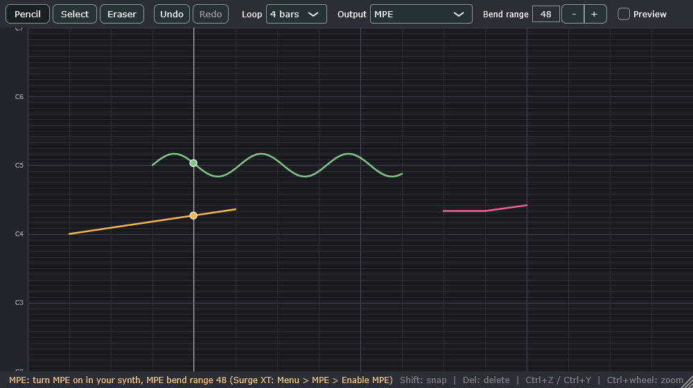

# PitchPaint

[](https://github.com/saitekii/PitchPaint/actions/workflows/build.yml)

A VST3 plugin for drawing music as free pitch curves. You draw with a pencil on a time × pitch canvas, and pitch is
**continuous**: a stroke can glide, wobble or sit between semitones. Each stroke plays as one note, strokes can overlap,
and the plugin drives an **external synthesizer** over MIDI using MPE or pitch bend.



## Features

- Pencil, Select and Eraser tools; Shift snaps the pencil to semitones.
- Any number of overlapping strokes: up to 15 sounding at once in MPE mode.
- Select, box-select, move (Shift: by whole semitones), delete; undo/redo.
- Loops of 1–16 bars following the host's transport; everything is saved with the project.
- Two MIDI output modes: **MPE** (one channel per stroke) and **Mono pitch-bend** (one stroke at a time, any synth).
- Built-in **Preview** sound that plays exactly what is drawn, as a reference for checking your synth.

## Building

Requires CMake ≥ 3.25 and a C++20 compiler (tested: Visual Studio 2022 Build Tools, MSVC 14.44, Windows 11).
JUCE 9.0.3 is fetched automatically at configure time.

```bash
cmake -S . -B build -G "Visual Studio 17 2022" -A x64
cmake --build build --config Release
```

On Windows, build from a short folder path (for example `C:\dev\PitchPaint`): MSBuild fails when the build
folder is nested very deeply (paths over ~260 characters inside JUCE's helper build).

The plugin ends up in `build/PitchPaint_artefacts/Release/VST3/PitchPaint.vst3`. Copy it to
`C:\Program Files\Common Files\VST3`, or add that folder to your host's VST3 search paths.

## Using it

1. Put **PitchPaint** on a track as an instrument, and your synth **after** it on the same track (or route
   PitchPaint's MIDI output to the synth's track). In REAPER: PitchPaint in FX slot 1, synth in slot 2.
2. Set up the synth for the output mode (see below). The yellow line at the bottom of PitchPaint's window
   reminds you what's needed.
3. Draw, press play in the host. PitchPaint loops its pattern while the host transport runs.

| Action | How |
|---|---|
| Draw | Pencil (P): drag. Shift: snap to semitones. Drawing back over a stroke redraws that part. |
| Erase | Eraser (E), or right-drag with any tool. Deletes every stroke the swipe touches. |
| Select / move | Select (S): click, Shift-click, or drag a box. Drag a selected stroke to move; Shift moves by whole semitones. |
| Delete selection | Delete or Backspace |
| Undo / redo | Ctrl+Z / Ctrl+Y (or Ctrl+Shift+Z), or the toolbar buttons |
| Select all / deselect | Ctrl+A / Esc |
| Scroll / zoom pitch | Mouse wheel / Ctrl+wheel |

The horizontal lines sit exactly on semitones (labels: C4 = MIDI 60 = middle C = 261.63 Hz).

> **REAPER and keyboard shortcuts:** REAPER may keep keys for itself. Enable *Send all keyboard input to plugin*
> in the FX window's menu, or use the toolbar buttons.

## Output modes and synth setup

A drawn pitch is sent as a **note number** (the semitone nearest the stroke's start) plus a continuous **pitch bend**.
The synth only follows the drawing if it applies the bend with **the same range** as PitchPaint's *Bend range*
setting. A mismatched range is the most common reason for "the sound doesn't match the drawing": the note
starts right but moves too little or too much.

### MPE (default)

- MPE lower zone: each sounding stroke gets its own member channel (2–16), so every stroke bends independently.
- On start and whenever settings change, PitchPaint sends the MPE Configuration Message and the bend range (RPN 0,
  default ±48 semitones) on every member channel.
- **The synth must be in MPE mode with the same member bend range.** Many synths need MPE switched on by hand.
  - **Surge XT:** Menu → MPE → *Enable MPE* (its MPE bend range defaults to 48). Surge ignores the MPE
    Configuration Message, so this must be done in Surge. *Verified.*
- New notes take the channel that has been free longest, so release tails are rarely bent by a new note.
  If more than 15 strokes sound at once, the oldest note is cut.

### Mono pitch-bend

- Everything on MIDI channel 1, one stroke at a time: the most recently started stroke wins, and an earlier
  one that is still running takes over again when it ends.
- Works with synths without MPE. **Set the synth's pitch-bend range to PitchPaint's *Bend range*.**
- If a stroke moves further than the bend range from its note, the note is retriggered on a new note number. That
  makes an audible re-attack, so use a large range (12–48) if your synth allows it.

### Resolution and timing

- Pitch bend is 14-bit: one step is about 0.6 cents at ±48 and about 0.02 cents at ±2.
- Note starts and ends are sample-accurate. Bends are updated every 64 samples (≈1.3 ms at 48 kHz), only when
  the value changes.
- Velocity is fixed at 100.

## Compatibility

VST3 has no raw MIDI output. Notes leave PitchPaint as VST3 note events, and pitch bend and controllers as
`LegacyMIDICCOutEvent`. **The host must pass a plugin's MIDI output on to another plugin.**

| Host | Status |
|---|---|
| REAPER 7.81 (Windows) | **Verified.** MIDI flows to the next FX on the track. Automated checks: MIDI as received by the next plugin matches the drawing within 0.03 semitones in MPE and mono modes; drawings survive save/reload. |
| Bitwig Studio, Cubase / Nuendo | Not tested. These hosts can route VST3 MIDI output, so they are expected to work. Reports welcome. |
| FL Studio, Studio One | Not tested; plugin MIDI output routing differs per host. |
| Ableton Live | Live does not route MIDI output from plugins. Only the built-in **Preview** sound works. |
| Logic Pro | Does not load VST3 (AU only). |

| Synth | Status |
|---|---|
| Surge XT | **Verified** in MPE mode with MPE enabled in Surge: follows the drawing within a few hundredths of a semitone. With MPE off it applies ±2 and doesn't follow; use Mono mode and set ranges to match. |
| Dexed | Not verified: it receives the MIDI, but its default patch couldn't be pitch-measured reliably. Should work in Mono mode with the bend ranges matched. |
| Other synths | MPE synths: enable MPE, match the bend range. Non-MPE synths: Mono mode, match the bend range. Synths in omni mode apply every channel's bends to every note, which breaks MPE mode. |

Other limitations:

- PitchPaint plays only while the host transport runs, and loops its own pattern (1–16 bars of 4 beats).
  A seek or host loop jump releases all notes; they restart from the new position.
- No MIDI file import or export yet.

## Tests

GitHub Actions builds the plugin on Windows and runs `CoreTests` and `EditorTests` on every push; the built
`PitchPaint.vst3` is attached to each run as an artifact.

```bash
ctest --test-dir build -C Release
```

- `CoreTests`: the JUCE-free core (pattern model, MIDI renderer, preview synth measured in Hz, undo, save format).
- `EditorTests`: the real editor and processor driven offscreen with synthetic mouse and key events.

End-to-end in REAPER (uses an isolated REAPER config and a dummy audio device; your REAPER settings are untouched):

```bash
powershell -ExecutionPolicy Bypass -File Tests/reaper/run.ps1
```

[pluginval](https://github.com/Tracktion/pluginval) (passes at strictness 10; GUI tests skipped because they open windows):

```bash
pluginval --strictness-level 10 --skip-gui-tests --validate-in-process --validate build/PitchPaint_artefacts/Release/VST3/PitchPaint.vst3
```

## License

AGPL-3.0-or-later (see [LICENSE](LICENSE)). Built with [JUCE](https://juce.com), used under the AGPLv3.
VST is a registered trademark of Steinberg Media Technologies GmbH.
